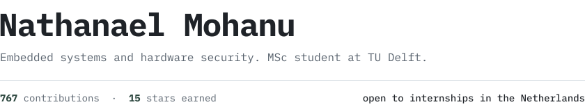

<picture>
  <source media="(prefers-color-scheme: dark)" srcset="assets/hero-dark.svg">
  
</picture>

 

My bachelor thesis at Leiden University was a side-channel analysis of the PROACT chip prototype.

**Projects**

- [bootloader](https://github.com/nathsys/bootloader): UART bootloader for STM32F4, in Rust
- [pyke](https://github.com/nathsys/pyke): perft engine, in C++
- [sunsnake](https://github.com/nathsys/sunsnake): chess move-generation library, in C++

[LinkedIn](https://www.linkedin.com/in/nathanael-mohanu-7a14b4183/)
