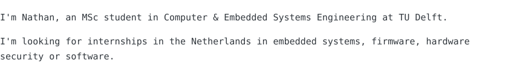
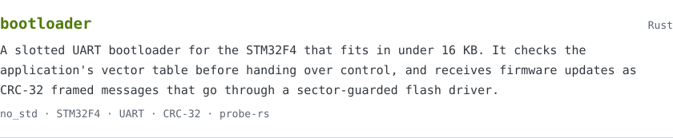
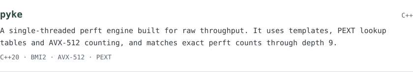
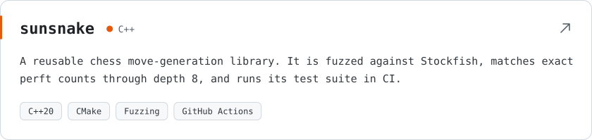
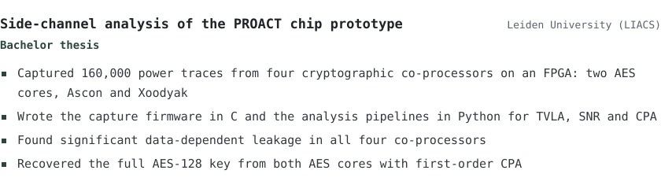
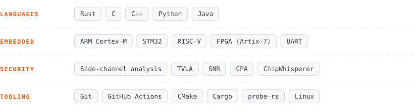

<picture><source media="(prefers-color-scheme: dark)" srcset="assets/hero-dark.svg"></picture>

<picture><source media="(prefers-color-scheme: dark)" srcset="assets/section-about-dark.svg"></picture>

<picture><source media="(prefers-color-scheme: dark)" srcset="assets/about-dark.svg"></picture>

<picture><source media="(prefers-color-scheme: dark)" srcset="assets/section-projects-dark.svg"></picture>

<a href="https://github.com/nathsys/bootloader"><picture><source media="(prefers-color-scheme: dark)" srcset="assets/project-bootloader-dark.svg"></picture></a>

<a href="https://github.com/nathsys/pyke"><picture><source media="(prefers-color-scheme: dark)" srcset="assets/project-pyke-dark.svg"></picture></a>

<a href="https://github.com/nathsys/sunsnake"><picture><source media="(prefers-color-scheme: dark)" srcset="assets/project-sunsnake-dark.svg"></picture></a>

<picture><source media="(prefers-color-scheme: dark)" srcset="assets/section-thesis-dark.svg"></picture>

<picture><source media="(prefers-color-scheme: dark)" srcset="assets/thesis-dark.svg"></picture>

<picture><source media="(prefers-color-scheme: dark)" srcset="assets/section-skills-dark.svg"></picture>

<picture><source media="(prefers-color-scheme: dark)" srcset="assets/skills-dark.svg"></picture>

<a href="https://www.linkedin.com/in/nathanael-mohanu-7a14b4183/"><picture><source media="(prefers-color-scheme: dark)" srcset="assets/contact-dark.svg"></picture></a>

