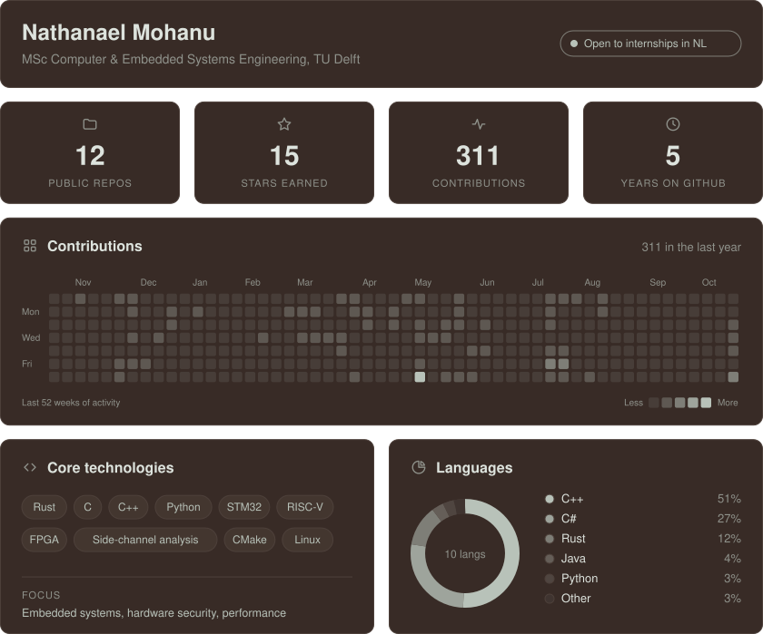

  

### Projects

| Project | Description |
|---|---|
| **[bootloader](https://github.com/nathsys/bootloader)** | Slotted UART bootloader for STM32F4 in Rust, under 16 KB, with CRC-checked firmware updates and a sector-guarded flash driver. |
| **[pyke](https://github.com/nathsys/pyke)** | Single-threaded C++20 perft engine reaching 2.4 billion positions per second, using PEXT tables and AVX-512. |
| **[sunsnake](https://github.com/nathsys/sunsnake)** | Reusable C++20 chess move-generation library, fuzzed against Stockfish and tested in CI. |

### Research

Bachelor thesis at Leiden University on side-channel analysis of the PROACT chip prototype. I captured 160,000 power traces from four crypto co-processors on an FPGA and recovered the full AES-128 key from both AES cores.

### Contact

Reach me on [LinkedIn](https://www.linkedin.com/in/nathanael-mohanu-7a14b4183/).
